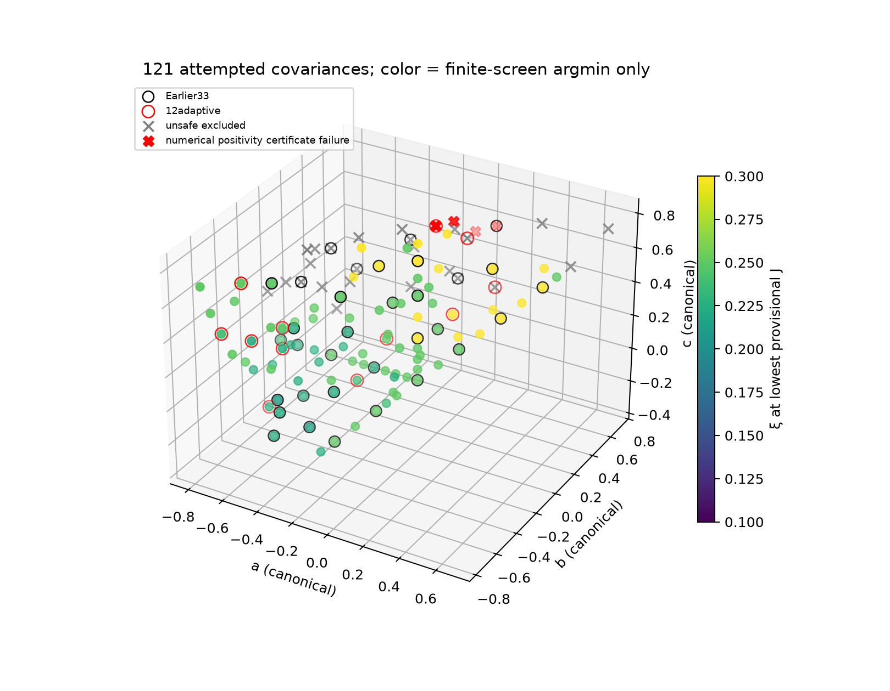
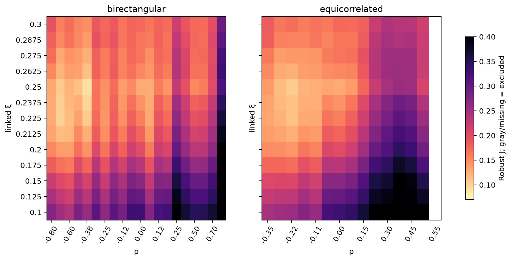
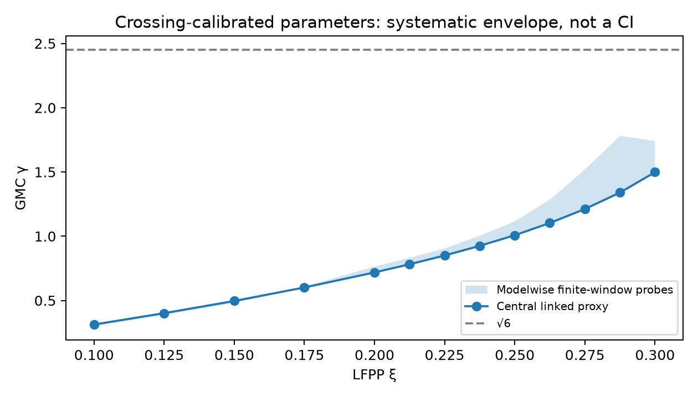
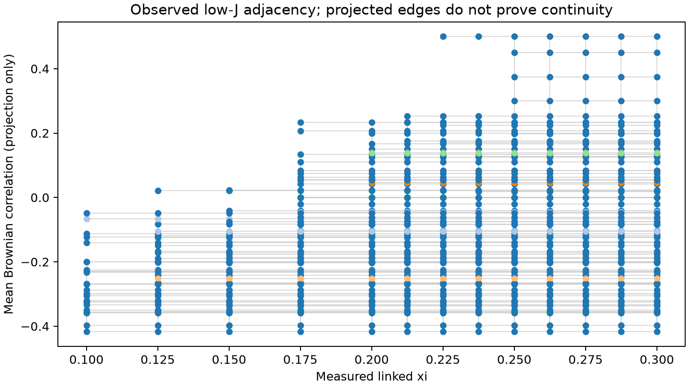
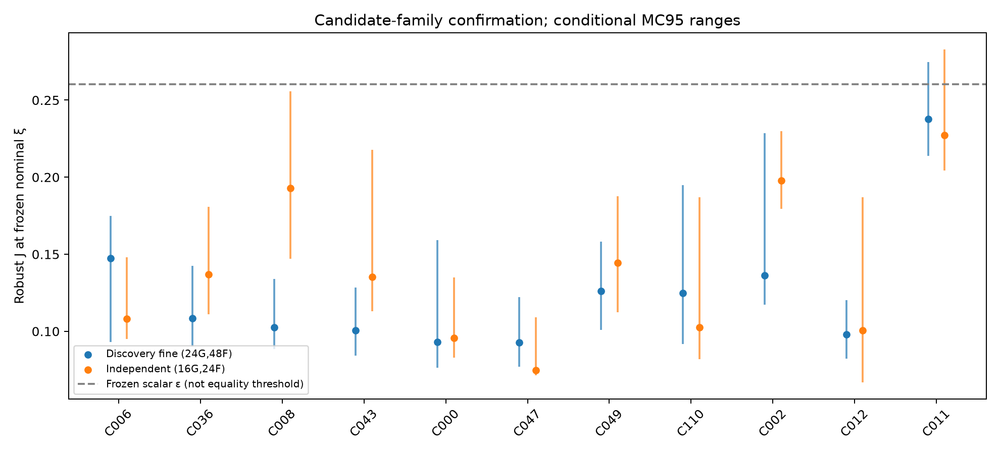
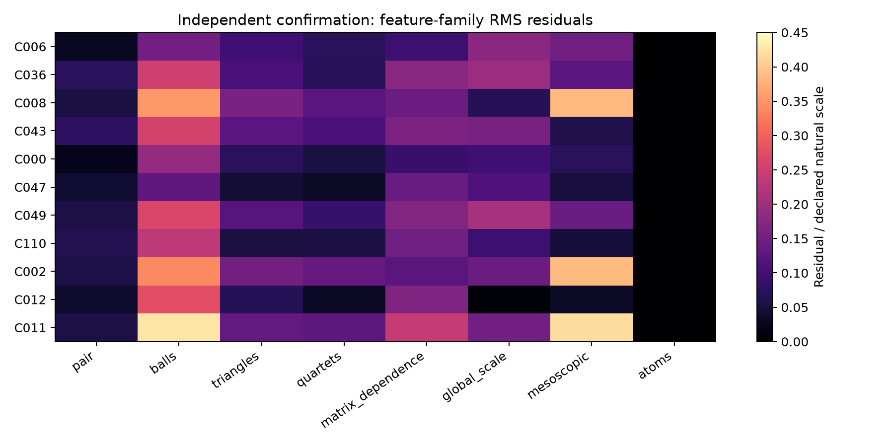
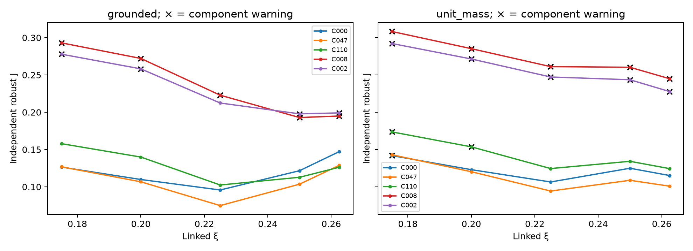
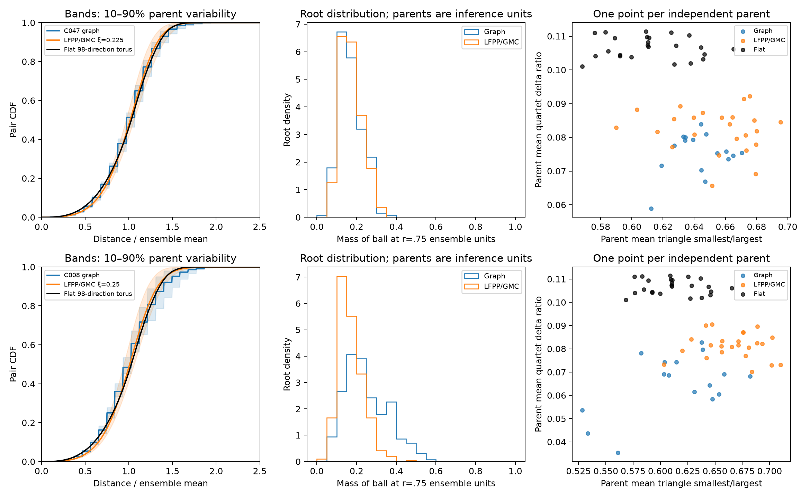

# Phase 3C — Broad search for intrinsic correspondence families

Research date: 12 November 2026. **Phase complete; stopped for review.** All frozen confirmation simulations, saved-data comparisons and final checks are complete. No Phase 3D work has begun.

## Executive finding

The search has expanded from 33 to **121 distinct permutation-canonical SPD covariance matrices**, with successful graph cohorts at **117** configurations. It finds extended regions of small finite-volume discrepancy, including negative equicorrelations, a substantial birectangular interval, and genuinely asymmetric examples. These regions are supported by actual neighboring simulations; they are not just curves drawn by a surrogate.

They do **not** identify a function γ=Φ(a,b,c), a distinguished one-dimensional covariance curve, or equivalent continuum metric-measure laws. The same simulated covariance often fits a broad interval of linked LFPP parameters under the available tolerances. Numerical sampler error, finite-volume ensemble differences, parameter-calibration uncertainty, and weak statistical identifiability remain comparable to the distinctions needed for family discovery. A thick low-discrepancy set is evidence of *finite numerical compatibility*, not evidence that geometries with different theoretical Hausdorff dimensions are identical.

The strongest surviving **provisional** hypothesis is a negative-equicorrelation region around ρ=−.30 to −.225, at nominal ξ=.225 and central finite-calibration γ=.850 (model probes .850–.905; conditional conversion MC95 .837–.889). A genuinely asymmetric extension also reproduces. Both negative equicorrelations and that asymmetric representative pass the frozen feature-family checks in both gauges. Their broad overlapping ξ support prevents identification of a unique parameter map.

The discovery-stage birectangular level segment ρ≈−.7 through +.065 does **not** survive as a whole under the componentwise confirmation criteria, although individual settings retain low scalar scores. Exact I3 retains its dimension tension; it is not assumed to be the preferred correspondence. The log-field geometry fits all tested graphs substantially better than flat geometry, which is a useful discrimination result but not model identification.

**Final assessment: partial or ambiguous correspondence.** There are extended finite-resolution candidate regions and independent support for several representatives, but **no convincing continuous continuum correspondence family has yet been identified**. Generic sampler error, small graph distances, compact-ensemble mismatch and finite-calibration uncertainty are the specific obstacles. The next useful step is a targeted ensemble/observable study, not another broad covariance sweep.

## Part I. Mathematical framework

### 1. Parameters and hypotheses

The Brownian covariance is

\[
C(a,b,c)=\begin{pmatrix}1&a&b\\a&1&c\\b&c&1\end{pmatrix},
\quad \det C=1+2abc-a^2-b^2-c^2>0.
\]

All experiments verify positive definiteness, minimum eigenvalue at least .15, and condition number at most 12. The sorted triple is a representative modulo coordinate relabeling: in dimension three all permutations of the three edge correlations arise from coordinate permutations. This avoids duplicate intrinsic union-graph laws. Sorting and constrained maximin sampling do not define a uniform prior on covariance space.

For C=RRᵀ, the whitened cone is W={z:Rz>0}. Its spherical triangle has interior angles, as an unordered triple, arccos(−a), arccos(−b), arccos(−c). If λ₁ is the principal spherical Dirichlet eigenvalue, α₁=√(λ₁+1/4) and p=α₁−1/2. The regular homogeneous harmonic is rᵖm(θ); the inward Doob harmonic is r^(−p−1)m(θ). The susceptibility exponent γ_s=1−α₁ is unrelated to the GMC parameter γ.

The applicable three-dimensional subcritical LFPP parameterization is

\[
\lambda_{\mathrm{cross}}(\xi)=1-\xi Q(\xi),\qquad
Q=\frac3\gamma+\frac\gamma2,\qquad
\xi=\frac\gamma{d_\gamma}.
\]

For ξ>0, the smaller branch is

\[
Q=(1-\lambda_{\mathrm{cross}})/\xi,\qquad
\gamma=\frac6{Q+\sqrt{Q^2-6}},\quad Q>\sqrt6.
\]

The ξ=0 control is treated separately as γ=0. The identities concern limiting exponents under the papers' assumptions. Our five-resolution crossing fit supplies only a finite-resolution calibration proxy. We never independently optimize γ and ξ for a claimed one-parameter correspondence. Named alternative calibration curves are global alternatives, not a choice of γ for each covariance.

The search asks whether an observed low-discrepancy set in (C,ξ) resembles a curve, level sets of a scalar map, several branches, or unstable finite-size coincidences. Neither the dimension of a scalar objective's sublevel set nor a smooth interpolated ridge identifies the dimension of a continuum matching family.

### 2. Primary sources and scope

Conventions were checked against the local primary PDFs, including Budd–Castro [arXiv:2207.05355](https://arxiv.org/abs/2207.05355), §§3.3–3.4 and 4.1; Contreras Hip–Zhuang [arXiv:2504.09141](https://arxiv.org/abs/2504.09141), Definition 1.7/Proposition 1.8, and [arXiv:2512.06292](https://arxiv.org/abs/2512.06292), §1.2/Corollary 1.9; Ding–Gwynne–Zhuang [arXiv:2310.03996](https://arxiv.org/abs/2310.03996), Proposition 1.1/Theorem 1.2; and Dello Schiavo–Herry–Kopfer–Sturm [arXiv:2302.02963](https://arxiv.org/abs/2302.02963). See [the convention audit](../docs/MATHEMATICAL_PROTOCOL_PHASE3C.md). Existence/tightness or weak-metric dimension results do not identify these graphs, establish uniqueness in the required setting, or supply a canonical graph field or Euclidean embedding.

## Part II. Numerical methods and resource strategy

### 3. Recovery and reuse

The interrupted calculation had completed all 19 initial graph batches. None was restarted. Recovery checked 3,607 NPZ archives without CRC failures and verified all 4,130 sealed Phase 3B artifacts against their recorded hashes. The recovered test suite passed 193 tests. [The recovery inventory](phase3c/resumption_20261112/completion_inventory.json) distinguishes complete data from planned work.

Graph screening used 12 independent physical paths per successful covariance at paired n=512 and 2048, with 16 iid counting-measure points per graph. Initial coverage reused 186 old parents and added 1,086. The adaptive round added 132 independent parents at 11 new successful settings. Thus the combined screen has **1,404 physical parents and 2,808 paired-size records**, including old reused parents exactly once. Repeated sizes do not increase the independent sample count.

Selected refinement used 24 parents per configuration at paired n=2048 and 8192 for 12 spread-out representatives: **288 parents and 576 records**, including 40 reused exact/exact-grid parents. Separate numerical-kernel controls do not enter the exact-reference ensembles. The independent confirmation plan freezes 11 configurations, 16 new graph parents each, before inspection of their metric statistics.

Gaussian field discovery uses 48 independent families: 24 cached Phase 3A families, 12 previous Phase 3B holdout families now explicitly treated as training, and 12 new families. Initial N32 has all 14 ξ values; initial N48 has 12 paired families. Selected refinement reuses the same 48 underlying fields at N32/N48, six ξ including zero. Independent confirmation uses 24 new families, IDs 1000–1023. Thus **72 distinct Gaussian families enter the study, 36 newly generated in Phase 3C and 36 reused**. Reusing a field over ξ, γ probes, grids, gauges or graph covariances never creates additional independent fields.

The final seed audit counts **1,724 newly generated physical Brownian paths**, deduplicated by covariance/seed and excluding all previously saved Phase 3B paths. The accounting is 1,218 new screen/adaptive paths, 56 Stage I paths, 248 new selected-refinement paths, 24 separate finest-kernel controls, two larger-graph cost pilots and 176 independent confirmation paths. Old reference cohorts are additional reused inputs, not counted as newly generated. Derived sizes and cached copies are repeated observations of a parent.

| Component | Physical parents / scope | Metric records / numerical levels |
|---|---|---|
| Broad plus adaptive graph screen | 1,404, including 186 reused | 2,808, paired n512/2048 |
| Selected graph refinement | 288, including 40 reused | 576, paired n2048/8192 |
| Independent graphs | 176 new at 11 configurations | 176, n8192 |
| Initial field screening | 48 total, with 12 at the larger grid | 840: N32/48, 14 ξ, 26 directions |
| Selected field refinement | Same 48 discovery families | 576: N32/48, six ξ, 98 directions |
| Main confirmation fields | 24 new; smooth subset eight | 240 log + 48 flat + 48 smooth records at N32/48 |
| Paired confirmation controls | Same eight confirmation families | 24 N64 + 24 matched-stencil records |

These tables do not add repeated stage observations into a fictitious count of independent realizations. The archive audit also includes small pilots and bootstrap archives; its file counts differ from physical-parent counts.

### 4. Field, measure and metric

The mean-zero unit-log torus field has Fourier covariance S(k)=1/(4π|k|³), k≠0, with sharp cutoff |k|<N/3. The zero mode is removed. Low-mode coupling is checked on actual complex Fourier coefficients, not inferred from using the same seed. The selected campaign found agreement to approximately 2×10⁻¹⁵. N64 extensions retain the already sampled N48 coefficients and add independent high modes in separate archives; earlier parent arrays are never replaced.

The same field generates LFPP and

\[
\mu_\gamma(dx)=\exp(\gamma h_N(x)-\gamma^2\operatorname{Var}(h_N)/2)dx.
\]

Both unnormalized mass M and probability measure μ/M are retained. Subcritical |γ|<√6 does not imply all moments: positive continuum moments require q<6/γ², and L² requires |γ|<√3. Upper sensitivity probes can therefore have particularly difficult mass tails even before the subcritical branch fails.

Distances are weighted lattice path lengths, using torus boundary conditions. Initial screening uses 26 directions; selected and confirmation work uses 98 primitive directions with periodic quadrature of interpolated exp(ξh). The fixed-stencil ξ=0 limit is a polyhedral norm, not exactly the Euclidean metric. Opposite-face cube crossings calibrate parameters; compact torus pair/ball distributions are a different observable and domain. Neither convention is silently substituted for the other.

Two gauges were prescribed before Phase 3C scores: grounded fields and the unit-mass Weyl shift D→M^(−ξ/γ)D. The latter is a field-dependent change of metric scale; it is **not** conditioning the ensemble on total mass one. Primary distance normalization divides by the deterministic ensemble mean pair distance. Ensemble-median normalization is a separate sensitivity. Per-realization normalization is used only in the explicitly labeled matrix-shape diagnostic.

### 5. Computation actually justified by pilots

Initial 840 field metric records required 589 seconds in five batches plus a 20-second pilot, with peak recorded RSS approximately 487 MB. An independently tested periodic kernel builder reproduces the old finite graph to edge/path relative error below 9×10⁻¹⁶ and reduces an N48/98-direction build from about 8.31 seconds to .16–.33 seconds. This changes implementation cost, not the finite metric definition. [Benchmark](phase3c/fields/periodic_kernel_validation/benchmark.json).

The selected 576-record N32/N48 refinement cost 347 seconds, peak RSS approximately 358 MB. Graph refinement ran in two-configuration batches, generally 73–131 seconds per batch. An n=16384 resource pilot completed, but the harder asymmetric case retained 2,322,130 path points, exceeding the predeclared 1.5-million-point budget. The planned fallback keeps general confirmation at n=8192; this is a resource decision, not a failed mathematical sample. The deterministic N64 pilot used approximately 658 MB and about 10 seconds for 48-source shortest paths. N64 is restricted to eight paired confirmation parents and three central ξ values.

Every batch stores seeds, exact settings, source hashes and independent checkpoints. A planned additional 52 discovery fields was deliberately not generated: it would tighten Monte Carlo error while leaving the measured sampler and ensemble systematics unresolved. This precision-only extension is optional, not a missing primary experiment. See [technical budget](../docs/TECHNICAL_PLAN_PHASE3C.md) and [status](phase3c/STATUS.md).

## Part III. Sampler reliability

### 6. Exact versus provisional targets

All principal graph comparisons use the **paper-biased** excursion law. The initial angular density is m²; the two inward legs have inverse-gamma(α₁,1/2) durations. Original fixed-duration excursions and this biased law are not interchangeable.

I3 has the exact biased excursion and continuous-minimum generator. A2×independent and A3 have exact finite-time matrix-bridge distributions, with approximate continuous *joint* cell minima. The A3 reference uses four-particle eigenvalue gaps and α₁=13/2; its canonical triple (−.5,−.5,0) is coordinate-equivalent to the user-specified (−.5,0,−.5). Generic and non-matrix birectangular paths use the existing stopping skeleton; analytic harmonics remove angular approximation error but do not make their clocks or continuous minima exact.

Initial general settings use degree-4 positive corner-factor Ritz harmonics, relative step .2 and base step .01, with finite exit-time approximation. Selected settings use degree 6, relative step .05, base step .0025 with the documented α-dependent scaling, 2,048 angular candidates, and exit order 12. The positive corner factors and mean-value audits mitigate the earlier P1 defects without certifying the full path law.

Angular directions use finite sampling/importance resampling, not an exact draw from m². The 56 new Stage I paths have importance ESS approximately 406–508 out of 1,024 candidates (ESS/candidates .397–.496; median ESS 460). This diagnostic concerns one angular candidate pool; it does not turn candidates into independent excursions, nor bound harmonic-function bias. Full angular metadata and numerical failures are retained per physical path.

### 7. Empirical error budget

The ten-configuration Stage I gate reused existing controls and generated only 56 missing fine paths. It retained a difficult degree-8 positivity-certificate failure rather than repeatedly attempting repair. At n=2048, the fine approximate kernel compared to independent controls gave:

| Control | Mean-distance relative residual | Conditional MC95 | Normalized pair W1 |
|---|---:|---:|---:|
| I3 | +1.27% | [−2.60%,3.99%] | .0263 |
| A2 | +3.00% | [−2.38%,9.52%] | .0442 |
| A3 | +4.32% | [1.06%,7.41%] | .0522 |

Whole-parent sampling, matched point counts and the same biased law are essential for this comparison. Fine-minus-coarse mean shifts ranged roughly −4.6% to +4.23%; shifts in ordinal joint-minimum diagnostics remained, including −.0731 (SE .0291) at C016 and +.0907 (.0334) at A2. These are not explained by a single global amplitude normalization.

Coupled thinning of one retained skeleton gave degree/edge Jaccard approximately .934–.939 at q32 and .981–.983 at q128, while mean-distance changes stayed below about .5%. Such stability does not control Brownian minima inside a retained sub-ball. It cannot justify independent marginal-minimum corrections in a correlated model. See [full sampler diagnostics](../docs/SAMPLER_RELIABILITY_PHASE3C.md).

The finest n8192 controls added later compare eight approximate parents with 24 exact/exact-grid reference parents, using 16 points per realization:

| Control | Mean-distance residual | MC95 | Approximate J / reference J at frozen nominal ξ |
|---|---:|---:|---:|
| I3, ξ=.25 | +1.36% | [−1.57%,3.51%] | .2074 / .1362 |
| A3, ξ=.225 | +2.11% | [.62%,5.01%] | .1500 / .0981 |

The differences in J are noisy and include independent graph sampling; they neither establish nor eliminate covariance-dependent sampler bias. Near-zero generic cones looking better than exact I3 cannot be interpreted as a physical discontinuity. [Finest controls](phase3c/families/refinement/control_analysis/summary.json).

### 8. Reliability classifications

Among the 117 successful coarse configurations there are one exact-continuous reference, two exact-grid references, and 114 numerical-kernel cases. **Twenty-four sampled configurations are excluded from family claims** by observed accumulated-defect flags; four additional attempted configurations fail the numerical positivity certificate: C022, C058, C065 and adaptive C116. All were SPD. These are numerical failures, not forbidden covariance matrices.

The exclusion gate is configuration-level: any observed leg with |Σlog(mean-value ratio)|>.03 or Σ|log ratio|>.10 triggers a warning, with the previously identified hard controls retained as unsafe. No inconvenient individual paths are discarded and replaced. A small diagnostic sum is not a path-law error bound: sphere quadrature, h approximation, normalization and skeleton errors can remain. The 93 permitted sampled settings are usable for **provisional exploratory screening**, not labeled validated arbitrary-covariance laws. Labels and every failed/unsafe configuration appear in the complete registry.

## Part IV. Broad covariance search

The initial 109-point design contains 20 birectangular, 15 equicorrelated, 25 two-correlation and 50 generic configurations; I3 is shared by the first two counts. It includes the previous 33 points rather than recomputing them. The constrained, permutation-canonical maximin design covers mixed signs and covariance regions far from A3/I3. Twelve adaptive additions increase total attempted coverage to 121; eleven produce full cohorts.

All actual matrices, cone angles, eigenvalues, condition numbers, sampler status, sample counts and full ξ profiles are saved in the [machine-readable registry](phase3c/tables_final/all_covariances.json), [CSV](phase3c/tables_final/all_covariances.csv) and [complete response surface](phase3c/tables_final/complete_response_surface.csv). Failure and warning rows are preserved. A scalar optimum is recorded descriptively, not substituted for the full profile.





The structured profiles show gradual covariance dependence, but the variation is not one-dimensional simply because a preferred ξ can be plotted. Large positive-correlation birectangular examples are less compatible in higher-point features in the tested ξ interval. Negative equicorrelations, negative birectangular values, and several strongly unequal triples have overlapping low-discrepancy profiles. Unsafe positive/mixed cones are displayed separately, not allowed to form an apparent correspondence branch.

## Part V. LFPP/GMC parameter search

Fourteen discovery values were actually tested:

0, .10, .125, .15, .175, .20, .2125, .225, .2375, .25, .2625, .275, .2875, .30.

The selected/confirmation values are 0, .175, .20, .225, .25 and .2625. Initial ξ=.325 and larger are not forced into the subcritical inversion: the inherited .325 calibration had only about 44% valid bootstrap inversions; .35/.375 have no valid central branch. Discovery therefore does not search an arbitrary γ/ξ rectangle.

| ξ | Central γ | Central γ/ξ proxy | Interpretation |
|---:|---:|---:|---|
| .15 | .49619 | 3.3079 | Lower discovery range |
| .20 | .71827 | 3.5913 | Selected/holdout |
| .225 | .85001 | 3.7778 | Negative-equicorrelation nominal hypothesis |
| .25 | 1.00771 | 4.0308 | Birectangular nominal hypothesis |
| .2625 | 1.10286 | 4.2014 | Upper selected profile |
| .275 | 1.21191 | 4.4069 | Higher discovery range |
| .30 | 1.49840 | 4.9947 | Stronger model/branch sensitivity |

Full finite-window model envelopes and bootstrap conversion intervals are in the [parameter table](phase3c/tables_final/linked_parameter_table.json). They must not be conflated: bootstrap intervals condition on a fitting model; the spread over fit windows and correction ansatz is a separate systematic probe, itself not an exhaustive bound on continuum error.



A specific inherited interpolation error was diagnosed without changing old data. Interpolating the central λ and then inverting is not the same as directly interpolating γ-envelope endpoints. At ξ=.2875 the inherited low γ=1.35515 even exceeded central γ=1.33967, and its high probe=1.62996 undercovered the properly modelwise envelope high=1.78069 by .15073. The broad surface retains those original labels and that limitation. Selected and confirmation data use the correct rule: interpolate each model's λ first, then invert and obtain its γ. Thus the main refined family conclusions do not rely on the bad interior endpoint interpolation. [Audit](phase3c/calibration/probe_interpolation_audit.json).

The maximum discrepancy over central/low/high is a conservative *uniform sensitivity requirement*, not the necessary condition that some one globally consistent calibration curve fits. Failing that maximum does not rule out the central curve or every named alternative. Confirmation saves each named global curve separately; none can be independently chosen for each C to manufacture a family.

## Part VI. Candidate equivalence families and identifiability

### 9. Prespecified statistics and tolerances

The 47 features include pair quantiles/tails, rootwise ball-mass dispersion at normalized radii .35,.5,.75,1,1.5, triangle ratios, quartet delta/aspect statistics, shared-root and disjoint-pair dependence, root-mean-distance CV, mesoscopic growth and degeneracy/atom diagnostics. Four prespecified family weightings are retained. Raw signed residuals are saved, so compensating discrepancies cannot be hidden by averaging into one score.

The primary J is a weighted mean of feature-family RMS residuals in declared natural units. Its ε=.26041420 was fixed from old-data-only same-model splits *before* Phase 3C scoring; unit-mass/mean ε=.20661248. The maximum cohort-specific 95th percentile is deliberately conservative: an old 12-field cohort's 6/6 splits contribute strongly to it. It is not a likelihood, an equality test, or a continuum error allowance. A secondary diagnostic also requires all family components to remain below their separately frozen split thresholds.

The response surface reuses one whole-graph and one shared whole-field bootstrap per draw, not fresh resampling for every C/ξ combination. There are 24 discovery feature-bootstrap draws. Conditional intervals do not account for Brownian systematic bias, field path discretization or model misspecification. Multiple pair entries, roots, triangles and quartets within one realization are dependent observations.

### 10. Observed sets, adaptation, and connectivity

At the initial screen, 842 eligible nodes passed the scalar gate. The combined adaptive screen has 944 such (C,ξ) nodes, forming six observed components under mutual-four-neighbor covariance adjacency, radius .25 and adjacent ξ gaps at most .0375. Radius .18/.32 and diagonal-edge sensitivities are saved. These are components of the measured sampling graph, not established topological components of an underlying matching set.

The componentwise condition is much more informative than the permissive scalar gate. Before adaptation it gave separate 20-covariance and 11-covariance negative-correlation groups and a seven-covariance near-I3 group. After twelve genuinely new probes, the first two groups merge into a **35-covariance observed region**, extending over ξ=.15–.2625 with central γ≈.496–1.103. This merger is supported by added measured neighbors, but its dependence on design density cautions against declaring disconnected physical branches. Strong componentwise support does not extend uniformly to the discovery ξ extremes.



The twelve additions were allocated to four observed-edge probes, three threshold-uncertainty probes, three component-disagreement probes and two maximin coverage points. They were not twelve variations of the global argmin. Examples include C109=(−.71433,−.65092,.40370), C110=(−.53072,−.39863,.24028), C112=(−.5923,−.5749,.3596), and new-coverage C119=(−.68036,−.30365,−.20686). C116's positivity-certificate failure and C117/C118's unsafe diagnostics are retained. [Measured adaptive results](phase3c/adaptive/analysis/scores.json).

### 11. Selected-family refinement

Twelve representatives were chosen across families and covariance ranges, not just the best three points. The following are the finer n8192 versus N48/98-direction discovery results, 24 graph parents and 48 field parents. MC95 is conditional whole-parent uncertainty; systematic errors are separate.

| ID | Canonical (a,b,c) | ξ at lowest refined J | J [MC95] | Componentwise-compatible queried ξ |
|---|---|---:|---|---|
| C006 | (−.7,0,0) | .25 | .1474 [.0930,.1750] | .20,.225,.25,.2625 |
| C036 | (−.375,0,0) | .25 | .1085 [.0902,.1424] | .20,.225,.25,.2625 |
| C008 | (−.25,0,0) | .25 | .1027 [.0884,.1341] | .20,.225,.25,.2625 |
| C043 | (0,0,.065) | .25 | .1005 [.0842,.1284] | .225,.25,.2625 |
| C011 | (0,0,.7) | .25 | .2376 [.2139,.2746] | None |
| C000 | (−.3,−.3,−.3) | .225 | .0931 [.0764,.1591] | All .175–.2625 queried |
| C047 | (−.225,−.225,−.225) | .225 | .0928 [.0771,.1223] | All .175–.2625 queried |
| C049 | (−.075,−.075,−.075) | .25 | .1261 [.1010,.1581] | None |
| C110 | (−.53072,−.39863,.24028) | .225 | .1249 [.0919,.1949] | .20,.225,.25,.2625 |
| C119 | (−.68036,−.30365,−.20686) | .225 | .0815 [.0731,.1400] | All .175–.2625 queried |
| C002 | I3 | .25 | .1362 [.1173,.2284] | None |
| C012 | A3=(−.5,−.5,0) | .225 | .0981 [.0822,.1201] | All .175–.2625 queried |

The broad support is the result to interpret, not just the smallest J in each row. The same graph fitting several ξ cannot identify a physical many-to-one map to every corresponding γ: those parameters have distinct theoretical metric dimensions if the limiting theory applies. It mainly demonstrates insufficient discrimination of these finite compact observables and the permissive noise reference. The plausible *level-set hypothesis* is that different C might share one ξ; that requires direct graph-to-graph comparisons, not simply matching each one loosely to LFPP.

### 12. Local rank and level-set checks

Local linear feature fits use several covariance radii, bootstrap operator-noise thresholds, and explicit warnings near the permutation quotient walls. Smooth covariance-dependent sampler error can mimic a derivative. Across 206 numerically fitted neighborhoods, 191 resolve no singular direction above the conditional operator-noise threshold and 15 resolve one; none resolves two or three. Some of these neighborhoods carry additional quotient-wall or conditioning exclusions. Statistical power is too low to establish rank one, two or three after noise and design conditioning are considered. A failure to resolve a singular direction is not proof of a universal scalar parameter. [Full local-rank table and projected field directions](phase3c/families/adaptive/local_feature_rank.json).

Direct graph-level-set comparisons retain 3,048 widely separated covariance pairs sharing an observed candidate ξ, with the full signed feature vector and graph-only noise reference. One hundred exceed that descriptive graph-only reference despite both having low cross-model scores. This is not 100 multiplicity-adjusted rejections. Non-rejection for other pairs is not equivalence; the same 12-parent samples and selection of low-J nodes limit inference. See [all level-set pairs](phase3c/families/adaptive/direct_graph_levelsets.json). Independent distance-matrix tests are kept separate from the primary objective.

## Part VII. Metric-measure comparisons and finite-size constraints

### 13. Distances, balls and higher-point geometry

Rootwise CDFs preserve full distance laws and ball masses rather than only the mean. Sixteen iid measure points per parent retain labeled distance matrices with 120 upper-triangle entries. Triangles and quartets are computed from these matrices without counting the subsets as independent replications. Mesoscopic ball growth and across-root versus across-realization fluctuations are distinct.

Full matrix-panel energy is measured in RMS Euclidean distance on the 120 coordinates, normalized in common ensemble units. Negative finite U-form estimates are retained. An audit of the legacy plug-in bootstrap found that repeated resampled parents bias an off-diagonal energy U-form upward; its naive percentile range is not a valid null confidence interval. Those old raw outputs are preserved but are not used as formal rejection evidence. Confirmation uses descriptive ensemble-scaled energy and a separate whole-parent permutation diagnostic of **per-parent-normalized matrix shape**. That sensitivity removes global-scale fluctuations and does not replace primary ensemble normalization. Unadjusted secondary permutation p-values are not family-wide discovery significance.

### 14. Growth and dimension

The paired n2048→8192 finite-distance slope β=log(mean distance ratio)/log4 is approximately .240–.265 among the twelve refined configurations. Its reciprocal ranges about 3.78–4.17. For example I3 gives β=.24784 [MC95 .24385,.25270], reciprocal 4.035; A3 gives .26293 [.25941,.26741], reciprocal 3.803. These are small-size growth proxies, not reliable asymptotic dimensions. [Complete paired growth table](phase3c/tables_final/refined_growth.json).

In particular, the I3 finite reciprocal near 4.03 does not supersede its much larger previously corrected asymptotic estimates. Phase 3B found additive-offset d≈4.910 [4.643,5.159] and an equation-(45) adaptation d≈4.856 [4.650,5.123], conditional on correction ansatz, compared with Budd–Castro's numerical 4.83±.06. Linked ξ=.25 implies central d_proxy≈4.03; ξ=.30 gives ≈4.995 but weaker calibration and less consistent refined compact-observable matching. This remains a material inconsistency to investigate, not a reason to force either fit into agreement. No general covariance Hausdorff dimensions are extrapolated from the screen's two sizes.

Changes from coarse D4/n2048/N32 to fine D6/n8192/N48 combine graph size, path accuracy, field resolution, stencil and sample changes. They must not be assigned to one error source. Paired graph-size observations and coupled field resolution/stencil checks isolate some contributions; none resolves the continuous-minimum bias. Bootstrap intervals do not absorb those systematics.

## Part VIII. Independent confirmation

### 15. Frozen tests and outcomes

The [frozen testing plan](phase3c/confirmation/frozen_plan.json) predates the independent data. It fixes the birectangular level-segment hypothesis at nominal ξ=.25; negative equicorrelations and asymmetric C110 at .225; I3/A3 anchors, C049 transition and C011 poor-fit comparator; and the complete discovery ξ support profiles. No holdout argmin is substituted for these nominal predictions.

All 176 new graph parents and 24 new field families are complete, including both grids, both fixed gauges, central/low/high probes, five global calibration models, flat and smooth controls, N64 extensions and matched stencils. Main scores use only central/low/high; named global models are assessed coherently as separate diagnostics. [All confirmation scores](phase3c/confirmation/analysis/scores.json), [complete table](phase3c/tables_final/independent_confirmation.csv), [signed features](phase3c/confirmation/analysis/point_features.json).

| Representative | Frozen ξ | Grounded robust J [conditional MC95] | All feature-family checks at nominal ξ: grounded / unit-mass |
|---|---:|---|---|
| C006, birect ρ=−.7 | .25 | .1080 [.0951,.1479] | Pass / Fail |
| C036, birect ρ=−.375 | .25 | .1370 [.1111,.1808] | Fail / Fail |
| C008, birect ρ=−.25 | .25 | .1929 [.1472,.2559] | Fail / Fail |
| C043, birect ρ=.065 | .25 | .1352 [.1129,.2178] | Fail / Fail |
| C000, equi ρ=−.30 | .225 | .0958 [.0827,.1348] | Pass / Pass |
| C047, equi ρ=−.225 | .225 | .0748 [.0715,.1090] | Pass / Pass |
| C049, equi ρ=−.075 challenge | .25 | .1445 [.1122,.1876] | Pass / Fail |
| C110, asymmetric extension | .225 | .1025 [.0819,.1869] | Pass / Pass |
| C002, exact I3 | .25 | .1979 [.1795,.2297] | Fail / Fail |
| C012, A3 exact-grid | .225 | .1005 [.0669,.1870] | Pass / Fail |
| C011, birect ρ=.7 comparator | .25 | .2273 [.2042,.2828] | Fail / Fail |

“Pass” is the frozen finite-noise diagnostic, not acceptance of equality. All nominal scalar scores are below the relatively loose grounded ε. The componentwise and gauge results substantially limit that apparently favorable scalar conclusion.



**Negative equicorrelation:** the two independent representatives at −.30 and −.225 reproduce low signed pair/triangle/quartet residuals and pass both gauges at ξ=.225. Both remain componentwise-low over all five queried ξ in the grounded gauge; C047 does so in both gauges. This is genuine replication of a regional finite-volume pattern, but the flat parameter profile supplies no identified slope dξ/dρ or unique Φ. Only those two equicorrelation points receive full independent confirmation; intermediate and other points have discovery evidence, not held-out validation of an entire interval.

**Birectangular segment:** the four-point shared-ξ=.25 hypothesis fails its componentwise confirmation. C006 passes grounded; C036/C043 pass grounded only at the *already frozen profile endpoint* ξ=.2625; C008 has no componentwise-low ξ in the five-value profile. This is not repaired by selecting new ξ or a preferred gauge. The full segment therefore is not a confirmed equivalence level set. These changes relative to discovery could reflect finite-cohort variability, retained graph discreteness, systematic approximation or a real geometric difference. The present data do not isolate the cause.

**Asymmetric extension:** C110=(−.53072,−.39863,.24028) passes both gauges at nominal .225, consistent with the negative-equicorrelation region and earlier sampled neighbors. One independently tested unequal triple does not confirm a two-dimensional level surface or an interpolated path to it. C119 remains a strong *discovery-only* asymmetric example; it was not silently relabeled as independently confirmed.

**Anchors and transition:** A3 fits grounded observables at .225 but fails the unit-mass component criterion. I3 fails at nominal .25 in both gauges; a grounded profile pass at .225 is not adopted as a new tuned candidate and would increase its dimension tension. C049 changes from a discovery component failure to a grounded holdout pass, while still failing unit-mass. This instability is another reason not to interpret the apparent region boundary geometrically.





The five global calibration curves do not remove these contrasts. At ξ=.225, C047 has J=.0610–.0748 across the named models, each passing the component criterion; C000 and C110 also pass each named model at their nominal ξ. At ξ=.25, I3 and C008 fail component checks for all five global models. These are comparisons of fixed model curves, not per-covariance γ optimization. [Model-indexed table](phase3c/confirmation/analysis/global_calibration_models.json).

Median normalization does not overturn the principal contrast. Grounded nominal J becomes .1479 for C000, .0807 for C047 and .1583 for C110, with componentwise compatibility retained in both gauges. C008 and I3 still fail the component criterion in both gauges. All four prespecified feature weightings give low scalar scores for the surviving representatives; the componentwise results, rather than choosing a favorable weighting, remain decisive. Mean/median differences are sensitivity to graph-hop atoms and random scale, not independent confirmation ensembles.

### 16. Distance, ball and full-matrix evidence

At the frozen nominal parameters, normalized pair W1 is .0285 for C047 [MC95 .0252,.0340], .0296 for C000 [.0263,.0343], .0324 for C110 [.0274,.0379], and .0306 for A3 [.0258,.0377]. C008 and I3 give .0415 and .0426. Full pair CDFs, root ball-mass distributions and one-point-per-parent triangle/quartet plots are shown below. Ball and mesoscopic residuals are often more discriminating than pair quantiles: for example C008's central ball-family RMS is .354 and mesoscopic RMS .384, despite pair RMS .053. [All intrinsic comparisons and MC ranges](phase3c/tables_final/metric_measure_comparisons.json).



A substantial portion of pair W1 is unavoidable at these graph sizes. Mean graph distances are only about ten hops, so normalized graph pair distances lie on a grid with spacing approximately .1. For any coupling to a field distance Y, W1≥E dist(Y,hℤ). The saved-CDF bin bounds put that nearest-lattice cost around .022–.025 for the tested graphs. C047's cost lies in [.02336,.02510], already close to its observed W1=.0285. This is a finite-data lower bound with a bin bracket, **not a Monte Carlo interval or proof that the remaining geometries match**. It shows why tiny pair discrepancies cannot be meaningfully optimized without addressing graph discreteness. [Derived lattice-cost table](phase3c/tables_final/distance_lattice_floor.json).

The labeled 16-point matrix-panel diagnostic retains global ensemble normalization. Ensemble energy estimates are small and signed: C047 −.00170, C000 .00049, C110 .00019, I3 .00330 and C011 .00744. The secondary **parent-normalized shape** permutation p-values are .72,.32,.41,.07,.01 respectively, with 99 whole-parent permutations. These unadjusted values are neither equivalence certificates nor multiple-comparison-adjusted rejection claims. Direct graph-to-graph shape tests among the proposed birectangular representatives give p=.34–.70; negative equicorrelations C000/C047 give .93. Thus these small matrix samples cannot establish equivalence or exclude shape differences missed by the feature vector. [Matrix diagnostics](phase3c/confirmation/analysis/matrix_diagnostics.json), [direct family tests](phase3c/confirmation/analysis/direct_graph_family_matrices.json).

### 17. Negative controls and paired numerical sensitivity

The central linked log-field model fits each of the 11 graph representatives substantially better than the flat 98-direction torus under the prespecified score: grounded log-minus-flat J ranges about −.241 to −.304, and every conditional whole-parent MC95 is negative. For C047, flat J=.340 versus log J=.0748; difference −.265 [−.275,−.234]. This establishes discrimination from flat geometry at these resolutions. It does not select a covariance map, since even the deliberately poor positive-birectangular comparator improves over flat. [Shared-parent control contrasts](phase3c/confirmation/analysis/log_minus_flat.json).

A variance-matched smooth, non-log-correlated control uses the same first eight fields. At fixed C047 features and ξ=.225, log J=.114 versus smooth J=.197 on that subset; log-minus-smooth difference −.0828, paired field-only interval [−.1111,−.0482]. This is evidence beyond a flat-only comparison, with only eight control families and one specified short-frequency model. It is not a general exclusion of smooth random geometry.

The same physical parents give the following unnormalized mean-distance changes. Distances still require resolution-dependent normalization, so these are not direct differences of limiting normalized metrics.

| Paired change | ξ values | Observed change |
|---|---|---|
| N32→N48, 98 directions, 24 parents | .175,.20,.225,.25,.2625 | −3.3% to −4.8% |
| N48→N64, 98 directions, same eight parents | .20,.225,.25 | −2.21%,−4.40%,−4.29% |
| N48 26→98 directions, same eight parents | .20,.225,.25 | −3.27%,−3.16%,−3.01% |

Normalization removes much of these scale changes, but not every shape change. At C047 and ξ=.225, N48→N64 lowers central J by .0202 on the common eight fields; 26→98 changes it by only .00009. This is useful local stability evidence, not convergence of all feature laws. N64 does not have 24 independent parents. [All paired signed-feature changes and conditional uncertainty](phase3c/confirmation/paired_checks/summary.json).

The confirmation runs cost approximately 1,039 seconds for main field batches plus 16.6 seconds for matched-stencil batches; maximum recorded main-field RSS was 784 MB. All jobs stayed within frozen memory/batch limits. The complete diagnostic analysis reused cached 32-draw features after a dictionary-key error in its final output step; no primary scores, hypotheses, raw samples or expensive bootstrap calculations were regenerated. The executed source snapshot and [diagnostic-only resumption](phase3c/confirmation/analysis/diagnostic_resume.json) preserve this provenance.

## Part IX. Mathematical interpretation

### 18. A finite-volume ensemble issue beyond numerical sampling

There is a specific mathematical distinction between the graph and field ensembles that persists even with a perfect sampler. Budd–Castro §3.3 changes the fixed-duration excursion law by

\[
\frac{d\mathbb P_{\rm biased}}{d\mathbb P_{\rm original}}(X)
=\frac{I_\alpha(X)}{C_\alpha},\qquad
I_\alpha=\int_0^1|R^{-1}X(t)|^{2\alpha-2}dt,\qquad
C_\alpha=\frac{2^{\alpha-1}\Gamma(\alpha)}{\alpha}.
\]

The normalization follows independently from the radial Bessel-bridge dimension 2α+2: its one-time moment, integrated with the beta integral in t, gives Cα. This positive absolute-continuity tilt preserves almost-sure exponents when defined under equivalent laws, but it does **not** preserve the law of global normalized distance matrices or random global geometry. A grounded torus Gaussian field, a unit-mass Weyl-shifted field, and a unit-volume-conditioned quantum geometry are likewise distinct ensembles.

Consequently, a residual global matrix-law mismatch need not be explained entirely by different local metric geometry. The correct compact ensemble/tilt for a proposed graph–field comparison is unresolved. New confirmation graph metadata record a discretized radial-bias integral for future diagnosis, but **no new reweighting is performed or selected for better agreement in Phase 3C**. Nor does this issue excuse every mismatch: it identifies a mathematical question that needs an explicit answer before global-law equality is conjectured.

### 19. What can and cannot be inferred

The observations support extended finite-volume compatibility regions rather than a single isolated optimum. They do not currently select a distinguished one-parameter covariance curve, prove two-dimensional covariance level sets, or separate physical branches robustly. Both broadened coverage and refined numerical controls weaken the interpretation of the earlier isolated I3 candidate as a uniquely natural match.

Possible explanations include shared coarse intrinsic geometry over a substantial covariance region, unresolved additional geometric parameters, finite-size compression of observables, ensemble tilts, and smooth numerical bias. None is established. A scalar fitted parameter, similar distance distributions, or equal dimensions would not identify continuum random metric-measure spaces. There is no proof of a three-manifold topology, a canonical Euclidean graph embedding, or 3D LQG convergence. A graph GFF is not automatically the required log-correlated field.

## Part X. Recommended next research directions

1. **Resolve the compact-ensemble comparison before another wide sweep.** Derive the effect of the paper-biased excursion tilt on intrinsic observables, and specify the field ensemble (grounded, Weyl-shifted, conditioned volume, or a justified tilt). Use the retained radial-integral metadata only as an explicitly designed future diagnostic. This is primarily mathematical work, followed by a small exact/special-cone experiment; it could explain global-scale/matrix residuals without inventing a covariance-to-γ curve.
2. **Test the analytic birectangular and negative-equicorrelation hypotheses with identifiable observables.** Retain several representatives across the observed intervals, exact I3/A3 controls, paired path/minimum refinement and shared LFPP fields. Prioritize the feature families and global calibration curves that confirmation distinguishes. Increasing graph size should follow a measured memory pilot; the n16384 retained-path cost already exceeds the harder-case cap. An exact/special-cone larger-size study is a more defensible asymptotic dimension test than extrapolating the present generic two-size slopes.
3. **Improve discrimination before finer optimization.** Use a prespecified larger sampled matrix size, independent parents, alternative compact-domain/field controls, and a fixed theoretical ξ interval. Estimate power for differences seen in ball dispersion, quartet shape and random global scale. Additional Gaussian fields can reduce field Monte Carlo uncertainty, but alone cannot validate generic Brownian minima or remove finite-calibration model bias.

No new major phase is started. The finite numerical evidence warrants these focused questions, not a new phase diagram or an asserted continuum conjecture γ=Φ(C).

## Reproducibility, checks and repository handoff

The final suite passes **214 tests in 10.27 seconds**, with zero failures, errors or skips. [Test record](phase3c/final_tests.xml). The read-only integrity audit checked **5,717 NPZ archives**, graph connectivity/Hamiltonian/chord invariants, distance-matrix symmetry/triangles, CDF monotonicity, probe aliases, field-source hashes, disjoint confirmation seeds and Fourier coupling. No partial archives were found. All **4,128 immutable artifacts** in the latest sealed Phase 3B finalization and its **120 source files** remain unchanged; the mutable README/research log are updated intentionally. Recovery had verified 4,130 artifacts before those document updates. [Integrity audit](phase3c/final_integrity.json).

Actual retained-mode discrepancies are at roundoff: selected confirmation N32/N48 coefficient probes ≤1.13×10⁻¹⁶ and N48/N64 extension probes ≤6.21×10⁻¹⁷. The implementation tests additionally verify the mode-extension convention and periodic-kernel equivalence. Checking a few saved coefficients is an archive consistency check; it does not substitute for those construction tests or field-law validation from Phase 3A.

The final parameter registry includes every attempted covariance and excludes unsafe cases from family claims while retaining their data. [Final registry](phase3c/tables_final/all_covariances.json), [final tables/figures](phase3c/tables_final/), [status and exact checkpoints](phase3c/STATUS.md), [preservation manifest and source snapshots](phase3c/final_manifest.json).

Reanalyze saved data into a **fresh output directory**; the producers refuse to overwrite completed archives:

```bash
OPENBLAS_NUM_THREADS=1 MPLCONFIGDIR=.mplconfig .venv/bin/python -m pytest -q
OPENBLAS_NUM_THREADS=1 MPLCONFIGDIR=.mplconfig .venv/bin/python -m experiments.phase3c_confirm_analysis --output results/reproduction_phase3c/confirmation --draws 32
OPENBLAS_NUM_THREADS=1 MPLCONFIGDIR=.mplconfig .venv/bin/python -m experiments.phase3c_consolidate --output results/reproduction_phase3c/tables
OPENBLAS_NUM_THREADS=1 .venv/bin/python -m experiments.phase3c_lattice_floor --output results/reproduction_phase3c/lattice_floor.json
```

`phase3c_graph_campaign`, `phase3c_refine_graphs`, `phase3c_confirmation_graphs`, `phase3c_fields`, `phase3c_selected_fast_fields` and `phase3c_confirmation_fields` retain exact batch plans and per-parent metadata for the executed simulations. The source index preserves older executed producer versions as well as final code. Some auxiliary plotting/audit drivers intentionally target the sealed handoff directories: use a separate checkout or a new output argument rather than rerunning them over existing results. The current main confirmation driver includes the diagnostic dictionary-key correction; the original executed version and cached-only finisher remain available.

No dataset was cleaned, moved or reorganized, no Git exclusion was changed, and nothing was committed or pushed. For eventual version control, track source, tests, environment locks, compact experiment plans/seed registries, mathematical protocols, research logs, reports, selected figures/tables and checksum manifests. Back up raw Gaussian fields, Brownian skeletons, graph archives, root distances and bootstrap caches separately in a versioned, checksummed archive or object store; keep the current paths and an indexed recovery manifest. Large essential raw data are not disposable merely because Git excludes them. Repository reorganization remains the user's decision after review.

**Stopped after Phase 3C.** The broad investigation and feasible confirmation are complete. Optional 52-field precision expansion, N96 grids and a general n16384 campaign were not performed; their absence is explicit and does not conceal missing results. The principal unresolved deliverable is a scientifically identifiable continuum correspondence family, which the current data cannot establish.
